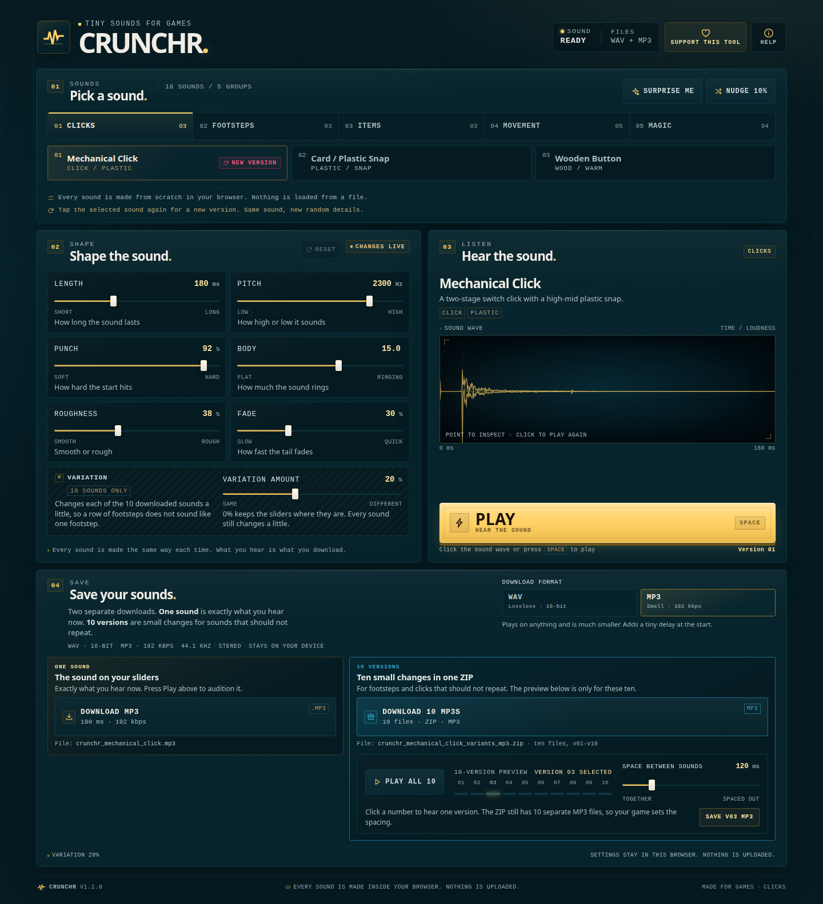
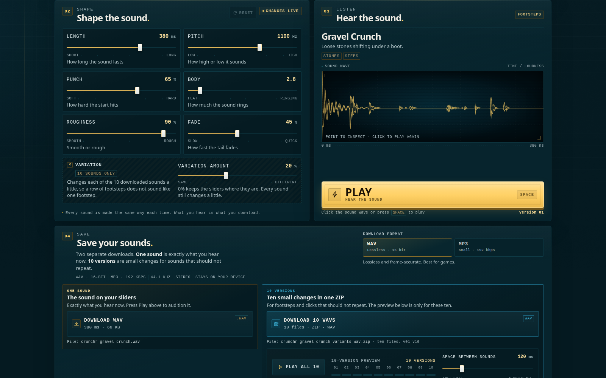
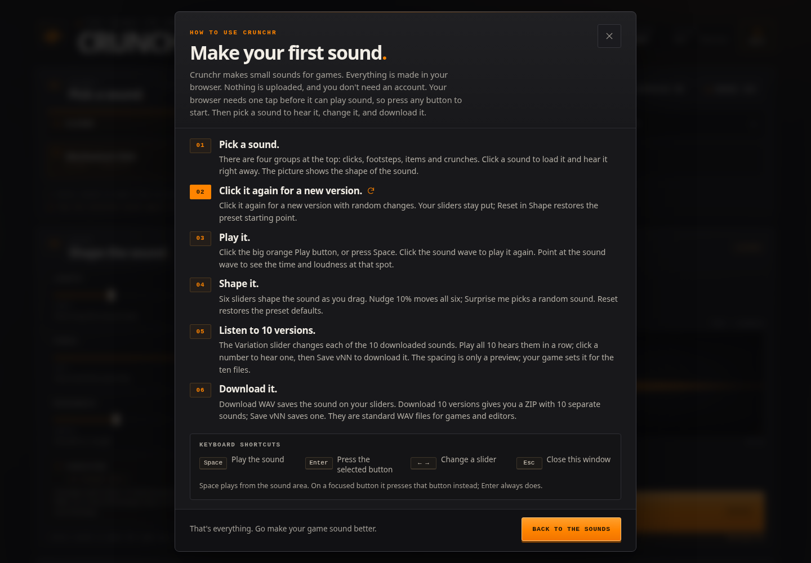
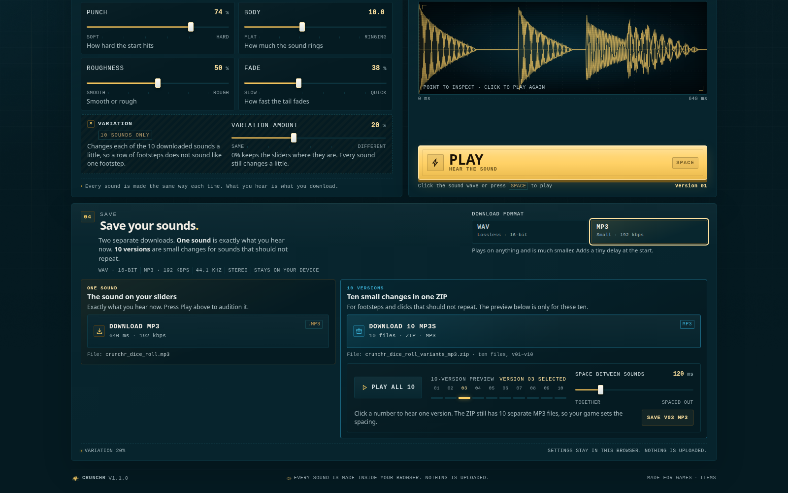

# Crunchr

Crunchr is a tiny sound maker I built for game projects. Pick a click, a
footstep, a jump, a coin, a spell zap, whatever your game is missing. Shape it
in the browser, then download a WAV or MP3.

Everything is generated in the browser. No samples, no uploads, no account.



## What you get

- **18 sounds in 5 groups**: clicks, footsteps, items, movement and magic.
- **6 live controls** for length, pitch, punch, body, roughness and fade, plus
  **Variation** for the 10-version batch.
- **One sound or 10**: save a single WAV/MP3, or a ZIP with 10 takes.
- **A live wave** that moves while the sound plays. Point at it to see the time
  and loudness.
- **Per-sound memory**: each sound keeps its sliders, version and seed in this
  browser.
- **Audition as you go**: picking a sound, re-rolling, nudging, surprising or
  resetting plays the result.
- **One renderer**: the wave, the audition and the exported file all come from
  the same seeded render.
- **A built-in manual, a phone layout and Spacebar playback.**
- **A support link** in the header opens the itch.io donation page in a new tab.
- **Works offline**, with no network calls, accounts or uploads.



## Try it

```bash
npm install
npm run dev
```

Open the URL Vite prints (usually <http://localhost:5173>). Click a sound to hear
it. **Space** plays it again. Browsers need one tap before they will play audio,
so the first click wakes it up and the header LED switches from **Tap to start**
to **Ready**.

Tap the sound you already picked and you get a new take. Your sliders stay put.
**Reset** in Shape puts them back to the preset defaults. In Save, choose **WAV**
or **MP3**, then download the sound on your sliders from the **One sound** card.
The **10 versions** card holds the ZIP and its preview: **Play all 10** plays the
whole set, a numbered button plays one take, and **Save vNN** keeps that file.
The **Help** button in the top right has the rest.

Not sure where to start? Pick the closest sound and change the sliders until it
fits.



### Keyboard & mouse

| Action | Control |
| --- | --- |
| Play the current sound | **Space** (from the page, scope, slider or active sound chip) |
| Activate a focused control | **Enter** |
| Replay | Click the sound wave or the large **Play** button |
| Make a new version | Click the active sound chip again |
| Reset the sliders | Click **Reset** in the Shape section |
| Tune a control | Drag, use the arrow keys, or type an exact value in the box |
| Select a sound | Click a group, then a sound chip |
| Preview the 10 versions | **Play all 10** in the Save section |
| Change the preview spacing | Drag or type into **Space between sounds** |
| Open the manual | Click the **Help** button in the top right |

Space stays a performance key where it matters: from the page, a slider, the
scope or the active sound chip, it plays the current sound. After picking a
sound the chip keeps focus, so Space replays it without another click. When any
other button is focused, Space activates that button natively: Help opens,
downloads start, Reset resets, and a non-active sound chip is selected. **Enter**
always activates the focused control. Space does not fire while a text field,
select or contenteditable element has focus.

Every slider also has a small value box. Type the value in the control's own
unit, like milliseconds, hertz, `%`, or bare Q for Body, and it updates the
sound as you type. Values outside the control's range are clamped on **Enter** or
when the box loses focus; **↑ ↓** steps the value and **Esc** reverts the edit.

## Controls

| Control | Range | What it does |
| --- | --- | --- |
| Length | 80–800 ms, log slider | Total rendered one-shot length |
| Pitch | 40–6000 Hz, log slider | Fundamental or filter centre; models map it to their material |
| Punch | 0–100% | Attack time (≈12 ms → ≈0.4 ms) and impact/transient gain |
| Body | Q 0.5–24.0 | Filter Q and modal ring/damping |
| Roughness | 0–100% | Tone ↔ granular noise/crackle balance |
| Fade | 0–100 | Linear fade → steep exponential tail |
| Variation | 0–50% | Batch-only amount of timing, pitch, body and texture drift |

### The models

| Category | Presets | Synthesis approach |
| --- | --- | --- |
| Clicks | Mechanical Click, Card/Plastic Snap, Wooden Button | Two-stage switch contact ticks, high-mid plastic resonance, card flex crackle with a flutter tail, inharmonic timber modes |
| Footsteps | Gravel Crunch, Wood Thud/Creak, Stone/Concrete | Granular band-passed noise clusters, low pitch-bent thumps with brief FM, swept-noise grit scuffs with short slap reflections |
| Items | Dice Roll, Cloth/Backpack Rustle, Coin Clink | 3–5 gravity-shaped bounce impacts, pink-noise fabric through modulated low-pass filters, dual inharmonic metal partials |
| Movement | Jump, Landing, Hit, Flesh Squish, Bone Crunch | Rising air with a low takeoff push, a heavy low landing with dust, a dry transient hit, plus the existing wet squelch and bone crunch |
| Magic | Arcane Zap, Magic Shimmer, Power-Up, Spell Whoosh | Downward harmonic sine arcs with crackle, rising inharmonic sparkle pings over an air bed, a four-note harmonic arpeggio, and opposing pink/white noise band sweeps |

The models live in [`src/audio/synthesis.ts`](src/audio/synthesis.ts). Every
sound uses the same six live controls, clamped at the extremes. Variation only
affects the ten-version batch.

## Batch variation

**Nudge 10%** moves each currently displayed control by a random factor in
`[0.9, 1.1]`, clamped to its range. The seed stays fixed. **Surprise me** selects
a random sound, seeds a fresh version and applies a bounded ±15% jitter.

The batch ZIP contains ten deterministic versions. With `d = humanize / 100`:

- duration and Q wander up to `±0.6d`
- pitch wanders up to `±0.4d`
- punch, grit and decay wander up to `±28d` percentage points
- every version always receives its own deterministic waveform seed, so even at
  Variation 0% the ten files have fresh granular texture. Variation 0% means no
  *parameter* drift.

All values are clamped and rounded before rendering. At the default 20%,
duration/Q vary by roughly ±12% and pitch by ±8%; at 50% they reach roughly ±30%
and ±20%. Every batch is generated from a snapshot taken at click time, so
changing a slider mid-export cannot corrupt the package.

**Play all 10** in the 10 versions card renders the same ten versions and plays
them back to back on the AudioContext clock. Click one of the ten numbered
buttons to audition that version on its own; **Save vNN** downloads just that
file as `crunchr_<preset_slug>_vNN.wav` or `.mp3`, matching the chosen format.
The **Space between sounds** slider (or its value box) sets a preview-only gap
from 0 to 600 ms in 20 ms steps.
Changing the gap while a preview is playing stops it so the next run uses the
new spacing. The gap is not written into the ZIP: the ten files stay separate,
and the game decides when to trigger each one.



## Export

Choose **WAV** or **MP3** at the top of the Save section. The choice applies to
every download in that pass. The one-sound card only saves the sound on your
sliders; the ten-version card only saves the batch and its individual takes.

- **Download WAV / MP3** → `crunchr_<preset_slug>.wav` or `.mp3`
  - WAV: RIFF/WAVE, PCM format 1, 44.1 kHz, 16-bit, stereo
  - MP3: MPEG-1 Layer III, 44.1 kHz, 192 kbps CBR, stereo
- **Save vNN** → `crunchr_<preset_slug>_vNN.wav` or `.mp3`
  - one humanized version from the ten-version preview
- **Download 10 WAVs / 10 MP3s** → `crunchr_<preset_slug>_variants_wav.zip`
  or `_variants_mp3.zip`
  - contains ten files, `crunchr_<preset_slug>_v01` through `_v10`
- `audioBufferToWav(audioBuffer)` is exported as a standalone utility in
  [`src/audio/wav.ts`](src/audio/wav.ts), alongside the pure channel-based
  `encodeWav(channels, sampleRate)`.
- `audioBufferToMp3(audioBuffer)` and `encodeMp3(channels, sampleRate)` live in
  [`src/audio/mp3.ts`](src/audio/mp3.ts). The MP3 codec is a WebAssembly build of
  LAME, loaded on the first MP3 action and encoded locally.
- WAV is lossless and frame-accurate. MP3 is much smaller and plays everywhere,
  but its encoder adds a short delay and padding at the start; use WAV for very
  short clicks or frame-accurate game sync.
- The WAV `RIFF`, `fmt ` and `data` sizes are derived from the rendered frame
  count, not fixed. 16-bit frames keep the data chunk frame-aligned, so a clip
  as short as the 80 ms minimum needs no pad byte; an 80 ms stereo clip is
  exactly 14,156 bytes. The smoke test checks those sizes byte for byte.
- All processing is local. Object URLs are revoked after download.
- Exports work even if the browser blocks live audio playback.

## Architecture

```text
src/
  audio/
    types.ts        shared parameter, preset and render types
    params.ts       ranges, clamps, slider mapping
    presets.ts      the 18-sound bank and categories
    random.ts       seeded PRNG, seed derivation
    dsp.ts          white/pink noise, RBJ biquads, envelopes, oscillators
    synthesis.ts    eighteen material models and finalization
    variations.ts   humanize, mutate, filenames
    wav.ts          standalone 16-bit PCM WAV encoder
    mp3.ts          lazy WebAssembly MP3 encoder wrapper
    export.ts       format-aware file builders, JSZip and download helpers
    engine.ts       lazy Web Audio playback and AnalyserNode
  components/       hardware UI, scope, presets, export dock, toasts
  hooks/            audio engine lifecycle, memoized rendering
  lib/format.ts     display formatting and typed-value parsing
  lib/session.ts    browser-local session memory (per-sound drafts)
  App.tsx           instrument state and interactions
  styles.css        design tokens, hardware styling, responsive rules
docs/
  screenshots/      the five real store captures
  crunchr-ui.png    full-page README capture
  crunchr-help.png  the in-app manual
scripts/
  browser-smoke.mjs headless Chrome smoke of the single-file artifact
  release-media.mjs screenshots, cover and banner from the real build
  check-release.mjs metadata, artwork, licence and artifact checks
  build-itch.mjs    packages and byte-verifies the HTML Game ZIP
```

### Why a deterministic DSP kernel?

Synthesis is performed by a pure TypeScript sample renderer at 44.1 kHz and
written into stereo float buffers. Live preview then uses the Web Audio API:
`AudioBufferSourceNode → GainNode → AnalyserNode → destination`. Filters,
oscillators, FM and noise generators are implemented mathematically rather than
as per-note Web Audio graphs, and there is intentionally no AudioWorklet or
deprecated ScriptProcessor. That choice gives us:

- **bit-identical WAV preview/export results**: all ten WAV ZIP versions use the
  exact same renderer as the live audition. MP3 is encoded from those same
  renders, then compressed by the local LAME codec;
- **fast triggering**: the buffer is rendered ahead of time and reused until a
  parameter or seed changes;
- **reliable single-file/offline builds**: no worklet module URLs to resolve;
- **no sample files whatsoever**.

The live output is real Web Audio, monitored in real time through
`AnalyserNode.getFloatTimeDomainData()` for the scope.

A render takes roughly 1–9 ms on a typical desktop, including worst-case
800 ms/6 kHz settings. The engine initializes on the first pointer or key
gesture, resumes if the browser suspended it, and uses a silent one-sample source
to satisfy strict mobile autoplay policies.

## Build & deploy

```bash
npm run build          # conventional static build → dist/
npm run build:single   # one self-contained HTML file → dist-single/index.html
```

Both builds use relative asset URLs. The single-file artifact is itch.io-ready
and can be opened directly from disk; everything (JS, CSS, JSZip and the MP3
codec) is inlined. To publish on itch.io, run `npm run itch:dist` and upload the
resulting ZIP as an **HTML Game**. The ZIP has `index.html` at the root and the
MIT licence. Set the embed to **Click to launch in fullscreen** so the instrument
gets the whole window. The app detects itch's frame and scrolls inside it, since
itch turns page scrolling off. The itch page copy, page fields, store art and
publish checklist are kept locally and ignored by git.

The production build includes a restrictive Content Security Policy. The single
file allows inline JS/CSS, data/blob images and `'wasm-unsafe-eval'` for the
inlined MP3 codec, and blocks all network egress. The development server uses a
separate policy that permits HMR.

### Release media and store kit

Every screenshot, the 630×500 cover and the 960×400 banner are real captures of
the single-file build in headless Chrome, not mock-ups:

```bash
npm run release:media   # rebuild the single file, then capture all nine images
npm run release:check   # validate fields, versions, image sizes, licence and CSP
npm run itch:dist       # package and byte-verify dist-itch/Crunchr-1.1.0.zip
```

`release:check` fails if the store metadata, the in-app footer, `package.json`
and `package-lock.json` disagree about the version or licence, or if a
screenshot is the wrong size. It never writes. `release:media` and
`release:check` use the local-only itch kit, so they need those ignored files
present. `itch:dist` reads the archive
back, checks the two expected file names (`index.html` and `LICENSE.txt`) and
compares `index.html` byte for byte with `dist-single/index.html`; a failed check
deletes the ZIP.

### Verify

```bash
npm run verify         # typecheck + unit tests + builds + headless Chrome smoke
npm run test:browser   # browser smoke against the existing dist-single build
npm run verify:browser # rebuild the single file, then run the browser smoke
npm run release:check  # validate the store kit, artwork, licence and artifact
```

Unit tests cover WAV header/sample encoding, MP3 frame encoding and determinism,
deterministic synthesis for all eighteen models, timbre regressions for the
click/snap/stone/flesh/magic/movement presets, swept-noise stability, live
control coverage, range clamping at parameter extremes, humanize drift bounds,
mutation bounds, session parsing/storage and ZIP contents.

The committed Playwright smoke (`scripts/browser-smoke.mjs`) opens the actual
`dist-single/index.html` artifact directly from disk and checks the first-gesture
audio arm, selecting a sound auditions it, Play/Space/sound-wave playback, live
scope, per-sound slider memory and Reset, re-rolling without losing the sliders,
the active category being a no-op, session restore after reload, native Space
activation on action buttons, the separate one-sound and ten-version cards, WAV
and MP3 single downloads, WAV and MP3 10× ZIP downloads, browser MP3 decoding,
single-version audition and byte-identical Save vNN, the help modal and its
Escape close, the batch preview, reduced motion, Save format/size, the itch-style
frame's internal scroll, touch-target sizes, the active chip's badge layout, and
overflow-free layouts at 1440, 390 and 320 px. It also checks the 390 px help
layout. It requires system Chrome;
set `CHROME_PATH` if Chrome is not in a standard location. A missing browser
fails the gate rather than silently skipping it.

## Browser support

Current evergreen Chrome, Edge, Firefox and Safari with ES2022, Web Audio and
WebAssembly support. The app uses native range inputs, semantic buttons and
Canvas, and honors `prefers-reduced-motion`. Audio can only start after a user
gesture, as required by browser autoplay policy. WAV export needs no WebAssembly;
if the browser cannot run the MP3 codec, the app reports it and WAV still works.

## Privacy

No accounts, analytics, telemetry, network requests or asset uploads. The
instrument is fully static and works offline. All generated audio stays in your
browser until you download a file. Your last session (active sound, per-sound
sliders, seed, version, variation amount and preview gap) is kept in browser
local storage on this device and is never uploaded; clearing site data removes
it.

## License

Crunchr is released under the [MIT License](LICENSE). The sounds you make with
it are yours to use in games, including commercial ones.

## Dependencies

React, JSZip, wasm-media-encoders (the LAME WebAssembly MP3 encoder), Vite,
TypeScript, Tailwind CSS, Vitest and Playwright Core. See
[THIRD-PARTY-NOTICES.md](THIRD-PARTY-NOTICES.md) for licenses. Pink-noise
filtering follows the widely published Paul Kellet approximation; all other DSP
code in this repository is original.

---

Made for games. Make something that crunches.
